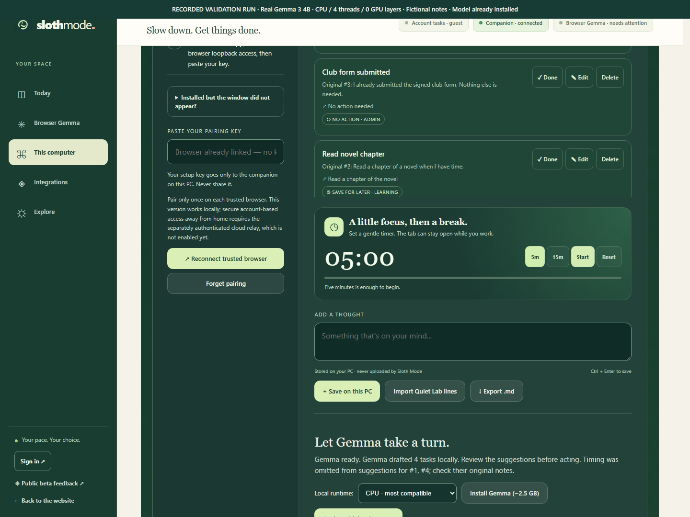

# Real Gemma browser demonstration and fresh checks

Recorded 24 October 2026. Fictional notes only. **[Watch the uncut 41-second recording](real-browser-gemma-uncut.mp4)** · [Actual browser/API observations](browser-run.json) · [Media hashes](media-provenance.json).



## What the recording establishes

A fresh headless Chromium context pairs with an isolated Go companion using the production P-256 signing flow. Four fictional notes are saved through the actual UI and processed by Gemma 3 4B Q4_K_M through the existing llama.cpp CPU runtime. The recording then edits a note, exports a briefing and reloads/reconnects the trusted browser. Original text remains available, and editing clears stale annotations. All seven recorded checks pass; 63 local API responses were observed and no uncaught page errors occurred.

The interval from clicking Plan to visible results was **25.063 seconds**, including model loading and UI polling. The recording lasts about **40.7 seconds**. These timings are not comparable to generation-only timings, a cold boot or human time saved. The full recording was transcoded to H.264 without cuts, speed changes, generated frames or audio. Video annotations identify it as a validation run.

## Exact validation boundary

- Windows CPU, four threads and zero GPU layers. No GPU inference, new model download, real account or personal note access.
- Existing model SHA-256 `4996030242583a40aa151ff93f49ed787ac8c25e4120c3ae4588b2e2a7d1ae94`; existing llama.cpp b11799 launcher SHA-256 `72109706e683889b95ec6f66006dee7e527a32c5e41859e0af3d4ea1fc6e3c31`. Launcher hash is not a claim about each runtime DLL.
- Production Go handlers, note storage, cryptographic pairing, prompt, parser and checks. Validation copies substitute only the allowed website origin/ports and cap the runtime to four threads. The UI snapshot matches the designer edition used for the existing live site.
- Fixture website `127.0.0.1:4190`, fixture companion `127.0.0.1:39872`; model service uses another loopback port. The real user's companion on 39871 is untouched.
- Browser traffic is restricted to these local fixture ports. The guest account-status route is a fixture. This does **not** establish machine-wide network disconnection, account integration, or production-origin/browser-permission behaviour.
- Software and model are already installed. This recording does **not** show a clean installation or model download.

Two earlier recording-test attempts are retained in local validation history: the first completed inference but expected automatic reconnect, while the product deliberately requires a reconnect click; the second detected a Windows test-helper cleanup issue by finding duplicated fictional notes. The final recording used directly managed child processes and a new data directory. Those were harness problems, not hidden model-quality reruns; the first completed inference and the final one both returned the same four priorities.

## A fresh predefined corpus

The [12 fictional inputs](inputs.json) and expected priorities were frozen before inference; [freeze metadata](freeze.json) records the input SHA-256 and candidate source-file hashes. These cases were new relative to the earlier 21 October corpus. They cover urgent/today/tomorrow, optional work, completed/reference notes, negated urgency and quoted instructions. The candidate triage contract was restored from previously tested rules before seeing these new results; it was not tuned on these outputs.

| Check | Baseline prompt | Explicit triage contract |
|---|---:|---:|
| Priorities matching the predefined labels | 9/12 | 12/12 |
| Predefined timing phrases repeated in summary/action | 0/9 | 1/9 |
| Structurally valid source IDs | 12/12 | 12/12 |

[Baseline output](baseline-results.json), [candidate output](candidate-results.json), [scores by note](scores.json). Each variant ran once in three batches of four, temperature zero, using the same existing model/runtime and four-thread CPU settings. Baseline startup was 3.336s; test body 57.86s. Candidate startup was 2.767s; test body 64.20s. No controlled speed comparison follows from these sequential runs. Category quality is unscored. These author-designed cases are a small convenience set, not a representative benchmark or user study.

**The remaining problem is visible:** correct priority does not imply a faithful summary. The candidate still omitted timing from seven notes. The new phrase-presence check flags all seven recorded cases for review against their original notes. It leaves model output and priority untouched. The English check is limited to the documented time/day phrases in `connector/timing_review.go`; it does not interpret dates, infer urgency, prove semantics, or cover every language. Paraphrases can trigger extra review, and semantic errors can remain even when the same words occur.

A separate source-integrity fix rejects a complete result batch if any input note was edited, completed, deleted or classified while inference ran. Tests verify no partial save and allow unrelated new notes. This prevents a fluent suggestion for old text being attached to a different current note.

## Reproduce without downloading models

Requirements: Windows, Go and Node already on PATH, Python with Playwright/Chromium already installed, and existing verified Q4_K_M model plus CPU runtime in a directory containing `models/` and `runtime-cpu/`.

From this repository root:

```powershell
python docs/evidence/2026-10-24/prepare.py --assets 'D:\existing-test-assets\SlothModeNative' --output 'D:\new-sloth-evidence-fixture'
python 'D:\new-sloth-evidence-fixture\run_demo.py'
```

Use a **new output directory per run**. Preparation refuses existing output and verifies the model hash. It creates fixture-only asset junctions, changes origin/ports in a source copy, caps CPU threads, compiles the opt-in test harness and copies the frozen UI. It never changes installed notes, startup settings or production origin policy. The fixed setup key is only for fictional fixture data, never for a production connector. The first command's generation/compilation was independently exercised during this work; the actual recording used the same substitutions and scripts. The runner manages its direct children and leaves recordings/data intact for inspection.

The corpus test uses the existing opt-in real-Gemma test pattern in an isolated source copy; default CI never downloads or runs the model. Re-score saved JSON without inference by comparing each output priority to `expected_priority` and checking the listed `timing_phrases`; this is exactly how `scores.json` was produced. The recorded omission regression in `connector/timing_corpus_test.go` checks the warning layer without model assets.
